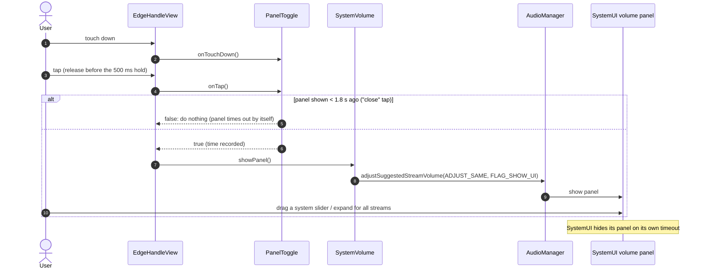
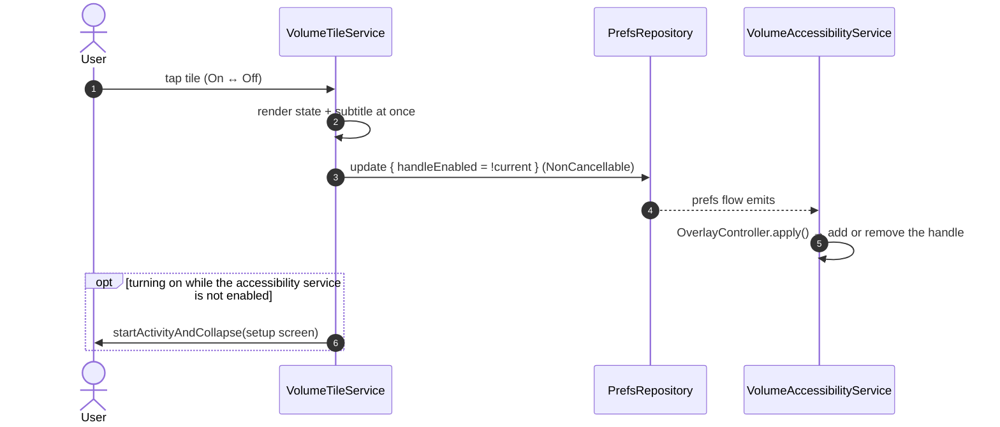
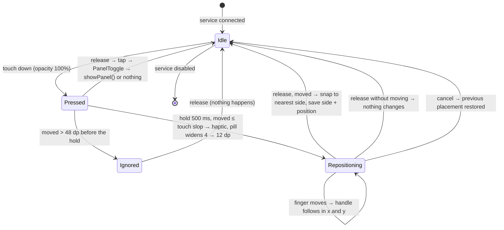

# 03 · Architecture


**Core idea:** EdgeVol draws **no volume UI of its own**. An always-available edge handle (and, from M3, a Quick Settings tile) is a *summon button*: a tap asks `AudioManager` to show **Android's own built-in volume panel**, on every app and every OEM skin. The panel's sliders do all the volume changes. *(M2.1: the earlier "drag along the handle steps the volume" behaviour was removed by user decision; only the system panel changes volume.)*

## Components

| Component | Responsibility | Key Android APIs |
|---|---|---|
| `VolumeAccessibilityService` | Process anchor. Bound by the system while enabled and re-bound after a normal process death or reboot (on MIUI only if Autostart is allowed, see below). Loads `Prefs` in a lifecycle-scoped coroutine, owns `OverlayController` and `SystemVolume`, and keeps watching `Prefs` so setup-screen changes apply live (M3). Exposes the process-wide `isRunning` flag. Ignores all accessibility events. | `AccessibilityService`, coroutines |
| `OverlayController` | Adds, positions, drags, snaps and removes the **single** handle window; `apply(prefs)` re-applies side, position, size and opacity live and removes the window when **Show handle** is off (M3); handles rotation; reports the snapped placement | `WindowManager`, `TYPE_ACCESSIBILITY_OVERLAY` |
| `EdgeHandleView` | Plain `View`: draws the pill (idle 4 dp, 12 dp while holding/dragging) and turns touches into intents: tap → show panel (via `PanelToggle`), hold → widen and drag, release → snap | `setSystemGestureExclusionRects`, haptics, `ValueAnimator` |
| `HandleGestures` / `HandleSnap` | Pure Kotlin: tap vs hold vs ignored movement; reposition deltas; nearest-side and position-percent maths (unit-testable, no Android types) | — |
| `PanelToggle` | Pure Kotlin with an injectable clock: decides whether a tap re-shows the panel or is swallowed because the panel was shown moments ago | — |
| `SystemVolume` | Thin wrapper around `AudioManager`: `showPanel()` only | `adjustSuggestedStreamVolume(ADJUST_SAME)`, `FLAG_SHOW_UI` |
| `VolumeTileService` | QS tile (M3) = the **Show handle** switch: tap toggles `Prefs.handleEnabled`, the tile shows On/Off; long-press opens EdgeVol; turning it on without the accessibility service opens setup. Starting the process also restarts a killed service immediately | `TileService`, `TOGGLEABLE_TILE`, `startActivityAndCollapse` (PendingIntent on API 34+), `StatusBarManager.requestAddTileService` (API 33+) |
| `MainActivity` / `SetupScreen` | Live service status in three states (Off / enabled but not running / Running), handle settings (side, height, size, opacity), tile card, deep links, Try-it (Compose, stateless) | `Settings` intents, Compose |
| `Prefs` / `PrefsRepository` | Handle side and vertical position (M2.1); size and opacity (M3) | DataStore Preferences |

**Deliberately not used (YAGNI):** a custom volume panel, Compose inside the overlay, notification-policy (DND) access, DI framework, Room, Navigation, multi-module, networking, analytics.

## How the system panel is shown

```kotlin
class SystemVolume(context: Context) {
    private val am = context.getSystemService(AudioManager::class.java)

    /** Shows Android's own volume panel without changing anything. */
    fun showPanel() = am.adjustSuggestedStreamVolume(
        AudioManager.ADJUST_SAME, AudioManager.USE_DEFAULT_STREAM_TYPE, AudioManager.FLAG_SHOW_UI,
    )
}
```

In the shipped code the wrapper also has an `internal constructor(adjust: (direction, streamType, flags) -> Unit)` so the JVM unit tests can inject a lambda instead of an `AudioManager`. *(M2.1 removed `step(up)`: EdgeVol never changes the volume itself, so there is no refused-step / Do Not Disturb case any more.)*

- `ADJUST_SAME` + `FLAG_SHOW_UI` shows the panel without changing anything; `USE_DEFAULT_STREAM_TYPE` lets **Android pick the stream exactly like the hardware keys do**, which decides what the panel highlights (call during a call, media while something plays, otherwise the device default).
- No activity is started; SystemUI draws its own dialog. So background-activity-launch limits don't apply, and it works from a service.
- The same technique is used in production by [DhwaniControl](https://github.com/RajnishKMehta/DhwaniControl) (Android 10–17) and *Volume Control: Native Volume*.
- **The panel cannot be closed by us.** Android has no API to dismiss it; it hides on its own timeout (MIUI 2.0 s, stock ~3 s). On the verified phone (MIUI 12.5) the panel window sits *below* our accessibility overlay, so a touch on the handle is never delivered to it as an "outside touch" and does **not** close it, whereas a touch on the app below the panel does (`dismissH reason:1`).

## Tap toggle (`PanelToggle`)

A tap shows the panel and remembers the time (`SystemClock.elapsedRealtime`). If the **next touch-down** on the handle arrives less than `PANEL_ASSUMED_VISIBLE_MS = 1800` after that, the panel is assumed to be still visible and the following tap is a "close" tap: the handle does nothing (no haptic, no new `showPanel()`) and forgets the timestamp, so the tap after that shows the panel again. Without it the second tap would re-request the panel and restart its timeout (on MIUI: a visible flicker).

- **Why 1800 ms:** MIUI's timeout is exactly 2.0 s from `showVolumeDialogH` (measured on the phone), stock Android is about 3 s. 1800 ms is just below the shortest known timeout, so we hardly ever swallow a tap when the panel is already gone. A wrong guess costs one extra tap (swallowed tap, or on stock Android a tap after 1.8 s re-shows while the panel is still up), never a failure.
- **What it does *not* do:** it does not close the panel on MIUI (see above); the panel just times out within ≤ 2 s. Whether stock Android / other skins close it on a touch over our handle is unverified; the setup copy therefore only promises "tap to show".
- TalkBack's click (`performClick()` without touch events) always shows the panel and records the time.
- TalkBack move actions (M4): `EdgeHandleView` adds *Move to left/right edge*, *Move up*, *Move down* to its node info (ids in `values/ids_system.xml`, only the moves `HandleSnap.moved` allows); performing one calls `OverlayController`, which applies the new placement and saves it through the same `onPlacementChanged` path as a finished drag.

## Summon flow: edge handle



## Quick Settings tile: the "Show handle" switch (M3)



The tile is a switch (`TOGGLEABLE_TILE` meta-data, `STATE_ACTIVE`/`STATE_INACTIVE`, subtitle On/Off on API 29+) for the same `Prefs.handleEnabled` flag as the setup screen's **Show handle** switch; while the shade is open it follows the stored value. Long-pressing it opens EdgeVol (`QS_TILE_PREFERENCES` on `MainActivity`), and a fresh launch of EdgeVol turns the handle on. Starting EdgeVol's process for the tile also makes Android run any pending restart of a killed accessibility service at once. Verified on the POCO X2: tile off → handle removed in ≈ 60 ms, on → added in ≈ 70 ms, long-press → EdgeVol opened and the handle came back.

*History:* the first M3 tile showed the volume panel through an invisible trampoline activity; the user chose a show/hide switch instead (handle hidden during games or video, back in one tap).

## Handle gesture state machine



- **Tap** = released with at most `TAP_MAX_TRAVEL_DP = 48` of travel (per axis) and no drag. Movement beyond the touch slop (≈ 8 dp) before the 500 ms hold cancels the hold (the release is still a tap while the travel stays within 48 dp); beyond 48 dp the touch is ignored. There is **no volume drag any more**.
- **Snap:** side = finger raw x < half the screen width → `LEFT`, otherwise `RIGHT`. Vertical position = the handle's dragged centre as a percentage of the screen height, rounded and clamped to 10–90%. The handle therefore does not jump on release. "Moved" means the finger travelled more than the touch slop after the hold fired.
- **Gesture exclusion:** the exclusion rect is the whole view in view-local coordinates, so it follows the window onto either side; it is refreshed after every layout/side change (API 29+).

## Window configuration

| Window | Type | Flags | Size | Attached |
|---|---|---|---|---|
| Handle | `TYPE_ACCESSIBILITY_OVERLAY` | `NOT_FOCUSABLE`, `LAYOUT_NO_LIMITS`, `LAYOUT_IN_SCREEN` | 24 dp × 56/72/120 dp touch area (M2: 72 dp). The visible pill is 4 dp idle and 12 dp while holding/dragging; the touch window never changes size | Always (while the service is enabled) |

`NOT_FOCUSABLE` ensures we never steal keyboard focus. `LAYOUT_IN_SCREEN` makes the vertical position a percentage of the real screen height. The window title is `EdgeVolHandle` so it can be found in `adb shell dumpsys window windows`. Gravity is physical `TOP | RIGHT` (or `LEFT`), never `START`/`END`; while dragging the window temporarily uses `TOP | LEFT` with explicit x/y, and on release it returns to the snapped side with `x = 0`. The handle is the only window EdgeVol ever adds. *Amendment approved by the user for M2.*

## Manifest sketch

```xml
<manifest xmlns:android="http://schemas.android.com/apk/res/android">
    <!-- Intentionally NO INTERNET, SYSTEM_ALERT_WINDOW, ACCESS_NOTIFICATION_POLICY or foreground-service permissions. -->

    <application android:icon="@mipmap/ic_launcher" android:label="@string/app_name">
        <activity android:name=".MainActivity" android:exported="true">
            <intent-filter>
                <action android:name="android.intent.action.MAIN" />
                <category android:name="android.intent.category.LAUNCHER" />
            </intent-filter>
        </activity>

        <!-- BIND_ACCESSIBILITY_SERVICE is signature-level: only the system can bind. -->
        <service
            android:name=".service.VolumeAccessibilityService"
            android:exported="true"
            android:label="@string/app_name"
            android:permission="android.permission.BIND_ACCESSIBILITY_SERVICE">
            <intent-filter>
                <action android:name="android.accessibilityservice.AccessibilityService" />
            </intent-filter>
            <meta-data
                android:name="android.accessibilityservice"
                android:resource="@xml/accessibility_service_config" />
        </service>

        <service
            android:name=".service.VolumeTileService"
            android:exported="true"
            android:icon="@drawable/ic_tile"
            android:label="@string/tile_label"
            android:permission="android.permission.BIND_QUICK_SETTINGS_TILE">
            <intent-filter>
                <action android:name="android.service.quicksettings.action.QS_TILE" />
            </intent-filter>
        </service>
    </application>
</manifest>
```

`res/xml/accessibility_service_config.xml`: minimal and privacy-preserving.

The service ignores all events, so M2 declares **no** `android:accessibilityEventTypes` (whether a service without event types still connects is verified on the phone). Fallback if it doesn't connect: `android:accessibilityEventTypes="typeWindowStateChanged"` plus `android:packageNames="app.edgevol"`, so only EdgeVol's own events are ever delivered.

```xml
<accessibility-service xmlns:android="http://schemas.android.com/apk/res/android"
    android:accessibilityFeedbackType="feedbackGeneric"
    android:canRetrieveWindowContent="false"
    android:description="@string/a11y_service_description"
    android:notificationTimeout="0"
    android:settingsActivity="app.edgevol.MainActivity" />
```

## Service sketch

```kotlin
class VolumeAccessibilityService : AccessibilityService() {
    private var overlay: OverlayController? = null
    private var scope: CoroutineScope? = null            // Main.immediate + SupervisorJob, cancelled on unbind/destroy

    override fun onServiceConnected() {
        teardown()
        scope = CoroutineScope(SupervisorJob() + Dispatchers.Main.immediate).also { s ->
            s.launch {
                // Defaults (RIGHT / 40%) if the read fails or takes longer than 1 s; never blocks the main thread.
                val prefs = withTimeoutOrNull(1000) { repository.prefs.first() } ?: Prefs()
                ensureActive()                                   // unbound meanwhile → no handle
                overlay = OverlayController(this@..., SystemVolume(this@...), prefs) { placement ->
                    s.launch { withContext(NonCancellable) { repository.update { it.copy(side = placement.side, positionPct = placement.positionPct) } } }
                }
                if (overlay!!.showHandle()) isRunning = true     // the flag implies "the handle was added"
            }
        }
    }

    override fun onUnbind(intent: Intent?): Boolean { teardown(); return super.onUnbind(intent) }
    override fun onDestroy() { teardown(); super.onDestroy() }
    private fun teardown() { isRunning = false; scope?.cancel(); scope = null; overlay?.removeHandle(); overlay = null }

    override fun onAccessibilityEvent(event: AccessibilityEvent?) = Unit
    override fun onInterrupt() = Unit

    companion object { @Volatile var isRunning: Boolean = false; private set }
}
```

The tile doesn't reach into the service at all (see the tile flow above), so no `instance` is needed.

### Why `isRunning` exists (verified on the POCO X2)

When the app process is killed on MIUI (e.g. "clear all" in Recents, or `am crash`), Android puts the accessibility service in *Crashed services* while `Settings.Secure.enabled_accessibility_services` still lists it; it is re-bound only when the restart is allowed (MIUI: Autostart, see [05](05-onboarding-and-permissions.md#service-enabled-but-not-running-miui-and-similar)). `enabled_accessibility_services` alone therefore says "on" with no handle. `SetupStatus.serviceRunning` (= `isRunning`) tells the setup screen the truth: a new process starts with `false` and only a real `onServiceConnected()` + added handle sets it. After `am force-stop` the *setting itself* is cleared, so the screen shows Off. A single off/on cycle in Settings does not always recover the service after a crash (the first `addView` can throw `BadTokenException`; a second cycle works); a bounded retry (4 attempts over ≈ 4.4 s, fresh `WindowManager` each time) was tried and **did not help**, so it was not kept.

### Rotation (M2.2)

The handle's vertical position is a percent of the full display height for the current orientation, so it keeps the same relative height in portrait and landscape. `currentWindowMetrics` read from the service context inside `onConfigurationChanged` can still describe the previous rotation, so the size used is the display's long and short sides mapped to the orientation from the `Configuration` (`HandleSnap.orientedSize`); `HandleSnap.windowTopPx` then places the window. The stored percent changes only after a drag, never on layout, so rotating back and forth returns to the same spot. Verified on the POCO X2: 10 % → y 141–339 px in portrait, 9–207 px in landscape.

## UI ↔ platform contract

This is the **only** API surface between `platform-dev` and `ui-dev` code (see the [agent team](07-agent-team.md)). Once it exists, both sides can be built in parallel. Changes need the manager's approval and an update here. The contract wins over the sketches above wherever they differ.

**Delivered per milestone.** Each signature is tagged with the milestone that introduces it. M1 ships only the parts tagged `M1`; the rest arrive with M2 and M3. In particular, M1's `SetupScreen` is `SetupScreen(status, onEnableService, onOpenAppInfo, modifier)`; the `prefs`, `onAddTile`, `onTestPanel` and `onPrefsChange` parameters are added in M2 (`onTestPanel`) and M3 (the rest). *Amendment approved by the user on 2026-10-17.*

**M2 additions (approved by the user):** `SystemVolume`; `SetupStatus.showRestrictedSettingsHelp: Boolean = false` (filled by `SystemSettings.status()` from `SDK_INT >= 33`, so `SetupScreen` stays stateless and SDK checks stay in platform code); `SetupScreen` gains `onTestPanel`.

**M2.1 changes (approved by the user as the "M2.1" change set):**
- `SystemVolume.step(up)` is **removed** (no drag-to-step volume).
- `Prefs` / `PrefsRepository` / `HandleSide` are **brought forward from M3**, but only with `side` and `positionPct`. `size` and `opacityPct` stay in `HandleDefaults` until M3, which adds them as extra defaulted fields (source-compatible). The overlay-internal `HandleSide { Left, Right }` is gone; the contract `data.HandleSide { LEFT, RIGHT }` is used everywhere.
- `SetupStatus.serviceRunning: Boolean = false` (third field, default-safe: old callers compile and never claim the handle exists), filled from `VolumeAccessibilityService.isRunning`.
- `ui.setup.SetupState { Off, EnabledNotRunning, Running }` and `SetupStatus.toSetupState()` (pure; `!serviceEnabled → Off` even if `serviceRunning`).
- New dependency (user-approved, part of the documented stack): `androidx.datastore:datastore-preferences` 1.2.1 (newest stable; 1.3.0-rc01 is a release candidate).

**Platform → UI** (owned by `platform-dev`):

```kotlin
// M2
package app.edgevol.audio
class SystemVolume(context: Context) {
    fun showPanel()
}

// M2.1 (side + positionPct only; M3 adds size and opacityPct)
package app.edgevol.data
enum class HandleSide { LEFT, RIGHT }
data class Prefs(
    val side: HandleSide = HandleSide.RIGHT,
    val positionPct: Int = 40,                   // 10..90, centre of the handle (coerced on read and write)
)
class PrefsRepository(context: Context) {
    val prefs: Flow<Prefs>                       // never throws for missing/unknown/corrupt data → defaults
    suspend fun update(transform: (Prefs) -> Prefs): Prefs   // M3: returns what was stored
}

// M3
enum class HandleSize(val heightDp: Int) { S(56), M(72), L(120) }
//   Prefs gains: val size: HandleSize = HandleSize.M, val opacityPct: Int = 35 (10..80),
//                val handleEnabled: Boolean = true                // "Show handle" switch and the QS tile
//   val Prefs.handleHidden = !handleEnabled                       // no handle window at all
//   DataStore keys: "size" (String), "opacity_pct" (Int), "handle_enabled" (Boolean; missing + opacity 0 = off)

package app.edgevol.system
data class SetupStatus(                                          // M1; M2 adds the second field, M2.1 the third, M2.2 the fourth
    val serviceEnabled: Boolean,
    val showRestrictedSettingsHelp: Boolean = false,             // M2: true on API 33+ (platform decides)
    val serviceRunning: Boolean = false,                         // M2.1: the service is connected in this process
    val showAutostartHelp: Boolean = false,                      // M2.2: Xiaomi/Redmi/POCO (Build.MANUFACTURER/BRAND)
)
object SystemSettings {
    fun status(context: Context): SetupStatus                    // M1
    fun accessibilitySettingsIntent(): Intent                    // M1
    fun appDetailsIntent(context: Context): Intent               // M1
    fun autostartSettingsIntent(): Intent                        // M2.2: MIUI Autostart list; caller falls back to appDetailsIntent
    fun requestAddTile(context: Context)         // M3: API 33+, no-op below (SetupStatus.canRequestAddTile tells the UI)
}
```

DataStore file `handle.preferences_pb` (keys `side`: String, `position_pct`: Int) under the app's private `files/datastore/`.

**UI** (owned by `ui-dev`): `MainActivity` hosts the setup screen and calls only the APIs above.

```kotlin
package app.edgevol.ui.theme
@Composable fun EdgeVolTheme(content: @Composable () -> Unit)    // M1

package app.edgevol.ui.setup
@Composable fun SetupScreen(
    status: SetupStatus,                         // M1
    prefs: Prefs,                                // M3
    onEnableService: () -> Unit,                 // M1
    onOpenAppInfo: () -> Unit,                   // M1
    onAddTile: () -> Unit,                       // M3
    onTestPanel: () -> Unit,                     // M2: calls SystemVolume.showPanel()
    onOpenAutostart: () -> Unit,                 // M2.2: MIUI Autostart list, fallback App info
    onPrefsChange: ((Prefs) -> Prefs) -> Unit,   // M3
    modifier: Modifier = Modifier,               // M1
)
```

M1 form: `SetupScreen(status, onEnableService, onOpenAppInfo, modifier)`.
M3 form (current): `SetupScreen(status, prefs, onEnableService, onOpenAppInfo, onTestPanel, onOpenAutostart, onAddTile, onPrefsChange, modifier)`. *Running* adds the **Handle** card (a **Show handle** switch row, side and size as segmented buttons, height 10–90 % and opacity 10–80 % sliders saving once per whole percent and always the final value on release) and the ready text switches to the "handle is hidden" wording when Show handle is off (both texts share one space, so nothing below jumps). A **Quick Settings tile** card shows in every state: *Add tile* button when `canRequestAddTile` (Android 13+), manual steps otherwise. `MainActivity` shows a change at once and saves it with `PrefsRepository.update` (`NonCancellable`; store emissions are ignored while its own saves are pending); the service picks the saved value up through its own `prefs` collector and moves the real handle. A fresh launch sets `handleEnabled = true`. `SetupStatus` gains `canRequestAddTile: Boolean = false`.
M2.2 form: `SetupScreen(status, onEnableService, onOpenAppInfo, onTestPanel, onOpenAutostart, modifier)`; the *Keep EdgeVol running* (Autostart) card shows in the *Running* and *Enabled but not running* states when `showAutostartHelp`, and the generic restriction hint shows only when it doesn't.
M2 form (unchanged in M2.1): `SetupScreen(status, onEnableService, onOpenAppInfo, onTestPanel, modifier)`. **Three states (M2.1):** *Off* (disclosure + Enable; the restricted-settings card only when `showRestrictedSettingsHelp`), *Enabled but not running* (plain-language explanation, button to Accessibility settings, a "switch off and on once more" line and a Xiaomi/MIUI hint shown on every phone) and *Running* (ready text). The screen never claims the handle exists unless `serviceRunning`. The *Try it* card shows in all states. `MainActivity` refreshes the status in `onResume` and once more after 1.5 s, because a healthy service in a fresh process connects slightly after the activity. `@Preview`s live in `app/src/debug/java/app/edgevol/ui/` (`ui-tooling` and `ui-tooling-preview` are `debugImplementation`). `MainActivity` stays in Recents so MIUI users can lock it (M2.2).

## Planned repository layout

```
phone_audio_control/
├── .github/
│   ├── copilot-instructions.md     # shared rules + file-ownership map
│   └── agents/*.agent.md           # manager, analyst, ui-dev, platform-dev, qa
├── .agents/skills/                 # repo-scoped agent skills (see 06)
├── skills-lock.json                # pinned skill sources + hashes
├── docs/                           # this documentation
├── settings.gradle.kts
├── build.gradle.kts
├── gradle/libs.versions.toml       # version catalog
└── app/
    ├── build.gradle.kts
    └── src/
        ├── main/
        │   ├── AndroidManifest.xml
        │   ├── java/app/edgevol/
        │   │   ├── MainActivity.kt
        │   │   ├── audio/SystemVolume.kt
        │   │   ├── data/{Prefs,PrefsRepository}.kt
        │   │   ├── overlay/OverlayController.kt
        │   │   ├── overlay/EdgeHandleView.kt
        │   │   ├── overlay/HandleGestures.kt       # HandleGestures + HandleSnap (pure)
        │   │   ├── overlay/PanelToggle.kt          # pure, injectable clock
        │   │   ├── service/VolumeAccessibilityService.kt
        │   │   ├── service/VolumeTileService.kt
        │   │   ├── system/SystemSettings.kt
        │   │   └── ui/{setup,theme}/…
        │   └── res/{xml,drawable,mipmap-anydpi,values}/…   # values/strings_system.xml = platform strings
        ├── debug/java/app/edgevol/ui/   # @Preview composables (debug only)
        └── test/                   # JVM: JUnit + Robolectric (Compose UI, overlay, tile); no androidTest (no emulator)
```

`app.edgevol` is the final application ID (user decision, M1).
