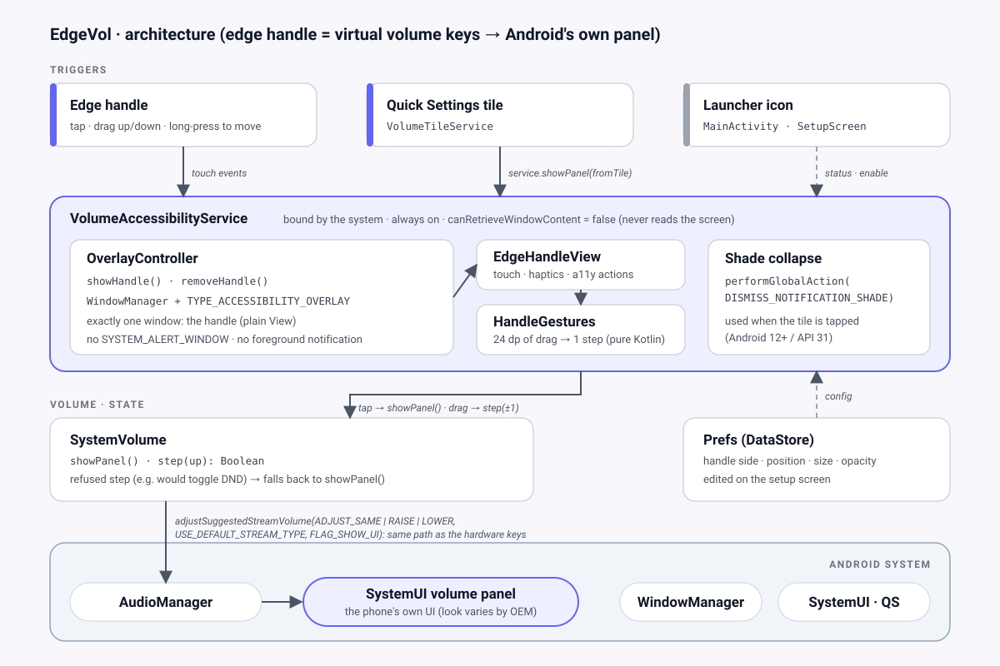
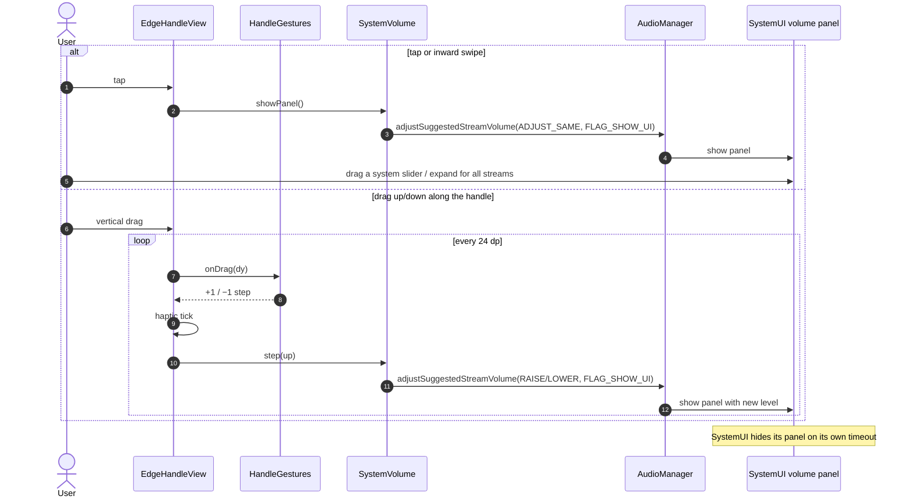
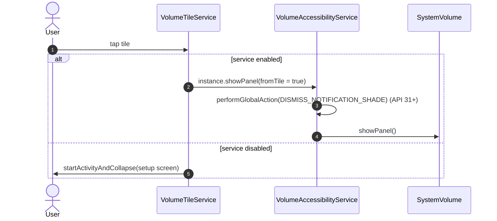
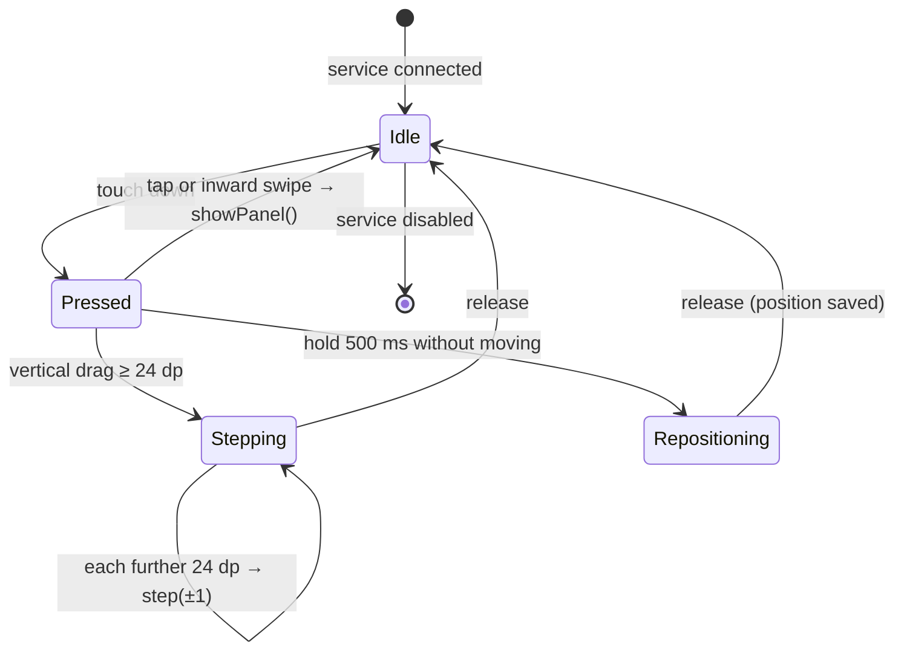

# 03 · Architecture



**Core idea:** EdgeVol draws **no volume UI of its own**. An always-available edge handle (and a Quick Settings tile) acts as a *virtual volume rocker*: it asks `AudioManager` to behave exactly as if a hardware volume key had been pressed. Android then shows **its own built-in volume panel**, on every app and every OEM skin.

## Components

| Component | Responsibility | Key Android APIs |
|---|---|---|
| `VolumeAccessibilityService` | Process anchor. Bound by the system while enabled, so it survives app swipes, reboots and battery savers. Owns `OverlayController` and `SystemVolume`. Ignores all accessibility events. | `AccessibilityService`, `performGlobalAction` |
| `OverlayController` | Adds, positions and removes the **single** handle window; re-applies `Prefs` and screen rotation | `WindowManager`, `TYPE_ACCESSIBILITY_OVERLAY` |
| `EdgeHandleView` | Plain `View`: draws the sliver and turns gestures into intents: tap / inward swipe → show panel, vertical drag → step volume, long-press → reposition | `GestureDetector`, `setSystemGestureExclusionRects`, haptics |
| `HandleGestures` | Pure Kotlin: maps drag distance to volume steps (unit-testable, no Android types) | — |
| `SystemVolume` | Thin wrapper around `AudioManager`: `showPanel()` and `step(up)`. A refused step falls back to `showPanel()` | `adjustSuggestedStreamVolume`, `FLAG_SHOW_UI` |
| `VolumeTileService` | QS tile: service on → collapse shade + show panel; service off → open setup | `TileService`, `StatusBarManager` |
| `MainActivity` / `SetupScreen` | Live service status, deep links, handle customization (Compose) | `Settings` intents, Compose |
| `Prefs` | Handle side, position, size, opacity | DataStore Preferences |

**Deliberately not used (YAGNI):** a custom volume panel, Compose inside the overlay, notification-policy (DND) access, DI framework, Room, Navigation, multi-module, networking, analytics.

## How the system panel is shown

```kotlin
class SystemVolume(context: Context) {
    private val am = context.getSystemService(AudioManager::class.java)

    /** Shows Android's own volume panel without changing anything. */
    fun showPanel() = am.adjustSuggestedStreamVolume(
        AudioManager.ADJUST_SAME, AudioManager.USE_DEFAULT_STREAM_TYPE, AudioManager.FLAG_SHOW_UI,
    )

    /** Same as pressing a hardware volume key. Returns false if Android refused it. */
    fun step(up: Boolean): Boolean = runCatching {
        am.adjustSuggestedStreamVolume(
            if (up) AudioManager.ADJUST_RAISE else AudioManager.ADJUST_LOWER,
            AudioManager.USE_DEFAULT_STREAM_TYPE,
            AudioManager.FLAG_SHOW_UI,
        )
    }.isSuccess
}
```

- `USE_DEFAULT_STREAM_TYPE` lets **Android pick the stream exactly like the hardware keys do**: call volume during a call, media while something plays, otherwise the device default (media on Pixel since Android 9, ring on many other OEMs).
- No activity is started; SystemUI draws its own dialog. So background-activity-launch limits don't apply, and it works from a service.
- The same technique is used in production by [DhwaniControl](https://github.com/RajnishKMehta/DhwaniControl) (Android 10–17) and *Volume Control: Native Volume*.
- **Refused step** (`SecurityException`, e.g. a step that would toggle Do Not Disturb): the caller falls back to `showPanel()` and the user finishes on the system slider, which SystemUI is allowed to change.

## Summon flow: edge handle



## Summon flow: Quick Settings tile



The tile and the service run in the same process, so the tile reaches the running service through a static `instance` set in `onServiceConnected()` and cleared in `onUnbind()`. No IPC is needed.

## Handle gesture state machine



## Window configuration

| Window | Type | Flags | Size | Attached |
|---|---|---|---|---|
| Handle | `TYPE_ACCESSIBILITY_OVERLAY` | `NOT_FOCUSABLE`, `LAYOUT_NO_LIMITS` | 24 dp × 56/72/120 dp touch area | Always (while the service is enabled) |

`NOT_FOCUSABLE` ensures we never steal keyboard focus. The handle is the only window EdgeVol ever adds.

## Manifest sketch

```xml
<manifest xmlns:android="http://schemas.android.com/apk/res/android">
    <!-- Intentionally NO INTERNET, SYSTEM_ALERT_WINDOW, ACCESS_NOTIFICATION_POLICY or foreground-service permissions. -->

    <application android:icon="@mipmap/ic_launcher" android:label="@string/app_name">
        <activity android:name=".MainActivity" android:exported="true">
            <intent-filter>
                <action android:name="android.intent.action.MAIN" />
                <category android:name="android.intent.category.LAUNCHER" />
            </intent-filter>
        </activity>

        <!-- BIND_ACCESSIBILITY_SERVICE is signature-level: only the system can bind. -->
        <service
            android:name=".service.VolumeAccessibilityService"
            android:exported="true"
            android:label="@string/app_name"
            android:permission="android.permission.BIND_ACCESSIBILITY_SERVICE">
            <intent-filter>
                <action android:name="android.accessibilityservice.AccessibilityService" />
            </intent-filter>
            <meta-data
                android:name="android.accessibilityservice"
                android:resource="@xml/accessibility_service_config" />
        </service>

        <service
            android:name=".service.VolumeTileService"
            android:exported="true"
            android:icon="@drawable/ic_tile"
            android:label="@string/tile_label"
            android:permission="android.permission.BIND_QUICK_SETTINGS_TILE">
            <intent-filter>
                <action android:name="android.service.quicksettings.action.QS_TILE" />
            </intent-filter>
        </service>
    </application>
</manifest>
```

`res/xml/accessibility_service_config.xml`: minimal and privacy-preserving.

```xml
<accessibility-service xmlns:android="http://schemas.android.com/apk/res/android"
    android:accessibilityEventTypes="typeWindowStateChanged"
    android:accessibilityFeedbackType="feedbackGeneric"
    android:canRetrieveWindowContent="false"
    android:description="@string/a11y_service_description"
    android:notificationTimeout="0"
    android:settingsActivity="app.edgevol.MainActivity" />
```

## Service sketch

```kotlin
class VolumeAccessibilityService : AccessibilityService() {
    private lateinit var volume: SystemVolume
    private lateinit var overlay: OverlayController

    override fun onServiceConnected() {
        volume = SystemVolume(this)
        overlay = OverlayController(this, volume).also { it.showHandle() }
        instance = this
    }

    fun showPanel(fromTile: Boolean = false) {
        if (fromTile && Build.VERSION.SDK_INT >= 31) {
            performGlobalAction(GLOBAL_ACTION_DISMISS_NOTIFICATION_SHADE)
        }
        volume.showPanel()
    }

    override fun onUnbind(intent: Intent?): Boolean {
        instance = null
        overlay.removeHandle()
        return super.onUnbind(intent)
    }

    override fun onAccessibilityEvent(event: AccessibilityEvent?) = Unit
    override fun onInterrupt() = Unit

    companion object { var instance: VolumeAccessibilityService? = null; private set }
}
```

## UI ↔ platform contract

This is the **only** API surface between `platform-dev` and `ui-dev` code (see the [agent team](07-agent-team.md)). Once it exists, both sides can be built in parallel. Changes need the manager's approval and an update here. The contract wins over the sketches above wherever they differ.

**Delivered per milestone.** Each signature is tagged with the milestone that introduces it. M1 ships only the parts tagged `M1`; the rest arrive with M2 and M3. In particular, M1's `SetupScreen` is `SetupScreen(status, onEnableService, onOpenAppInfo, modifier)`; the `prefs`, `onAddTile`, `onTestPanel` and `onPrefsChange` parameters are added in M2 (`onTestPanel`) and M3 (the rest). *Amendment approved by the user on 2026-10-17.*

**Platform → UI** (owned by `platform-dev`):

```kotlin
// M2
package app.edgevol.audio
class SystemVolume(context: Context) {
    fun showPanel()
    fun step(up: Boolean): Boolean               // false = refused by Android → caller calls showPanel()
}

// M3
package app.edgevol.data
enum class HandleSide { LEFT, RIGHT }
enum class HandleSize { S, M, L }
data class Prefs(
    val side: HandleSide = HandleSide.RIGHT,
    val positionPct: Int = 40,                   // 10..90, centre of the handle
    val size: HandleSize = HandleSize.M,
    val opacityPct: Int = 35,                    // 0 = tile-only mode
)
class PrefsRepository(context: Context) {
    val prefs: Flow<Prefs>
    suspend fun update(transform: (Prefs) -> Prefs)
}

package app.edgevol.system
data class SetupStatus(val serviceEnabled: Boolean)              // M1
object SystemSettings {
    fun status(context: Context): SetupStatus                    // M1
    fun accessibilitySettingsIntent(): Intent                    // M1
    fun appDetailsIntent(context: Context): Intent               // M1
    fun requestAddTile(context: Context)         // M3: API 33+, no-op below
}
```

**UI** (owned by `ui-dev`): `MainActivity` hosts the setup screen and calls only the APIs above.

```kotlin
package app.edgevol.ui.theme
@Composable fun EdgeVolTheme(content: @Composable () -> Unit)    // M1

package app.edgevol.ui.setup
@Composable fun SetupScreen(
    status: SetupStatus,                         // M1
    prefs: Prefs,                                // M3
    onEnableService: () -> Unit,                 // M1
    onOpenAppInfo: () -> Unit,                   // M1
    onAddTile: () -> Unit,                       // M3
    onTestPanel: () -> Unit,                     // M2: calls SystemVolume.showPanel()
    onPrefsChange: ((Prefs) -> Prefs) -> Unit,   // M3
    modifier: Modifier = Modifier,               // M1
)
```

M1 form: `SetupScreen(status, onEnableService, onOpenAppInfo, modifier)`.

## Planned repository layout

```
phone_audio_control/
├── .github/
│   ├── copilot-instructions.md     # shared rules + file-ownership map
│   └── agents/*.agent.md           # manager, analyst, ui-dev, platform-dev, qa
├── .agents/skills/                 # repo-scoped agent skills (see 06)
├── skills-lock.json                # pinned skill sources + hashes
├── docs/                           # this documentation
├── settings.gradle.kts
├── build.gradle.kts
├── gradle/libs.versions.toml       # version catalog
└── app/
    ├── build.gradle.kts
    └── src/
        ├── main/
        │   ├── AndroidManifest.xml
        │   ├── java/app/edgevol/
        │   │   ├── MainActivity.kt
        │   │   ├── audio/SystemVolume.kt
        │   │   ├── data/Prefs.kt
        │   │   ├── overlay/OverlayController.kt
        │   │   ├── overlay/EdgeHandleView.kt
        │   │   ├── overlay/HandleGestures.kt
        │   │   ├── service/VolumeAccessibilityService.kt
        │   │   ├── service/VolumeTileService.kt
        │   │   ├── system/SystemSettings.kt
        │   │   └── ui/{setup,theme}/…
        │   └── res/{xml,drawable,mipmap-anydpi,values}/…   # values/strings_system.xml = platform strings
        ├── test/                   # JVM + Robolectric
        └── androidTest/            # Compose UI + on-device
```

`app.edgevol` is a placeholder application ID. Renaming is trivial until M1 is built.
