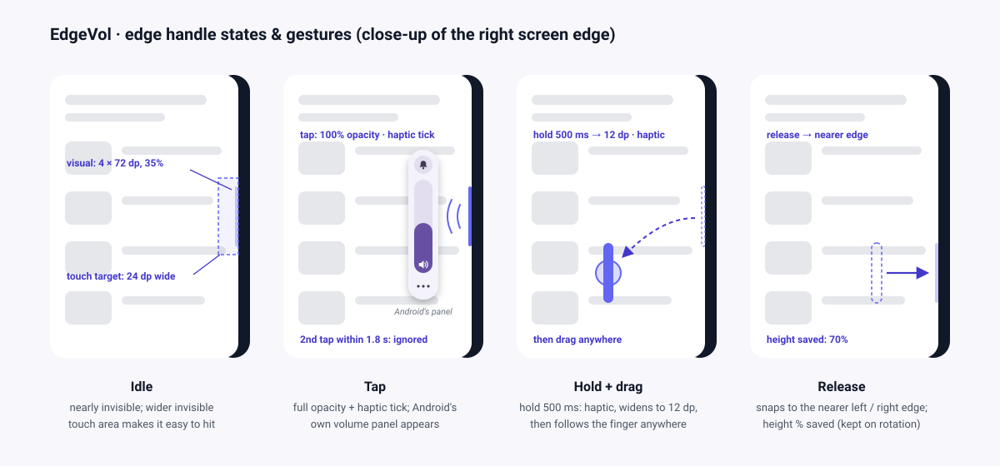

# 04 · UI design

> Principles: **invisible until called · Android's own volume panel, one tap away · zero clutter.**

EdgeVol draws only two things: the **edge handle** and the **setup screen**. All volume UI comes from **Android's built-in volume panel** (SystemUI), so it looks and works like the phone's normal panel on Pixel, Samsung, Xiaomi and others.

## Edge handle: a summon button you can park on either side

| Gesture | Result | Feedback |
|---|---|---|
| **Tap** | Shows the system volume panel without changing anything. A second tap within ~1.8 s is swallowed (it does not re-request the panel; see [03](03-architecture.md#tap-toggle-paneltoggle)) | haptic `CONTEXT_CLICK` only when the panel is shown |
| **Touch and hold 500 ms, then drag anywhere** | The handle **widens** (4 → 12 dp, solid, 100% opacity) so you know it is ready, then follows your finger in both directions. On release it **snaps to the nearest screen edge** (left or right half) at the height you released, clamped to 10–90%, and the position is saved | haptic `LONG_PRESS` when it widens; returns to idle size and opacity on release |
| Hold and release without moving | Nothing changes | — |
| Move more than 48 dp before the hold fires | Ignored (no panel, no drag) | — |

**There is no drag-to-change-volume gesture** (removed in M2.1 by user decision): the volume itself is only changed with the sliders of Android's own panel.

| Property | Default | Configurable |
|---|---|---|
| Side | Right | Hold + drag to the left or right half of the screen; **saved** (DataStore) |
| Vertical position | 40% of screen height (centre of the handle) | Hold + drag; **saved** and restored after a service restart or reboot; a slider in settings comes in M3 |
| Visual size | 4 dp × 72 dp pill (12 dp while holding/dragging) | S 56 dp / **M 72 dp** / L 120 dp (M3) |
| Touch area | 24 dp wide (invisible), never resized | — |
| Opacity | 35% (100% while touched) | 10–80% (0% = "QS tile only" mode) (M3) |
| Color | `primary` from the theme (dynamic color on Android 12+) | — |

**Back-gesture conflict (gesture navigation):** Android's *back* is a **horizontal** inward swipe from either edge. The handle is a tap/hold target, and we register its bounds with `setSystemGestureExclusionRects` (capped at 200 dp per edge; the largest handle is 120 dp). The rect is view-local, so it follows the handle to whichever side it is on. Whether MIUI honours exclusion rects for an accessibility overlay is unverified (`dumpsys window` shows nothing for it) and is part of the manual script.

## The system volume panel (what the user sees after a gesture)

- **Look, position and timeout** are controlled by the phone's SystemUI. On Pixel it's a vertical pill on the right; Samsung and Xiaomi have their own styles. EdgeVol can't restyle, move or **close** it, by design (MIUI hides it after 2.0 s, stock Android after ~3 s).
- **Which stream** the panel highlights is decided by Android exactly as for the hardware keys: call during a call, media while playing, otherwise the device default.
- **Other streams** (ring, notification, alarm): the user taps the panel's own expand / ⋯ button. Android has no public API to open the expanded view directly.
- **Mute / ringer mode:** use the panel's own mute and ringer icons.

## Motion & haptics

| Event | Motion | Haptic |
|---|---|---|
| Touch down | Opacity → 100% (the width does not change yet) | — |
| Tap → panel | (system panel animates itself) | `CONTEXT_CLICK` |
| Swallowed "close" tap | — | none |
| Hold fires (500 ms) | Pill widens 4 → 12 dp over 120 ms (instant when animations are off), solid, drawn centred while dragging | `LONG_PRESS` |
| Release | Handle snaps to the nearest side, narrows back to 4 dp and idle opacity over 160 ms | — |

## Theming (setup screen + handle)

- **Material 3**, `dynamicDarkColorScheme` / `dynamicLightColorScheme` on Android 12+, falling back to the brand palette:

| Token | Light | Dark |
|---|---|---|
| Brand primary | `#4F46E5` (indigo) | `#A5B4FC` |
| Brand secondary | `#7C3AED` (violet) | `#C4B5FD` |

- The setup screen is edge-to-edge (Android 15+ enforces it). See the repo skill `edge-to-edge`.

## Accessibility of our own UI

- The handle exposes a content description ("EdgeVol volume handle"); TalkBack's double-tap click always shows the panel. Custom accessibility actions (*Show volume panel*, *Move to left/right edge*) are planned for M4 so Switch Access users don't need the hold-and-drag gesture.
- Setup screen: content descriptions, ≥ 48 dp targets, font scaling, and *Remove animations* respected.

## Setup / settings screen

| Section | Content |
|---|---|
| Status | **Three states.** *Off*: disclosure, *Enable*, restricted-settings help (Android 13+). *Enabled but not running*: "On, but not running" with the explanation that this happens when the app is cleared from Recents, a button to Accessibility settings, "switch it off and on once more" and a Xiaomi/MIUI hint (lock in Recents, allow Autostart, Battery "No restrictions"). *Running*: "On" and where to find the handle and how to use it. The handle is never claimed unless the service is really running. Later (M3): *Add Quick Settings tile* |
| Handle (M3) | Side · Position (10–90%) · Size (S/M/L) · Opacity (0–80%) with a live preview on the screen edge |
| Try it | *Show volume panel* button (calls `SystemVolume.showPanel()`) in every state |

## Logo

| | |
|---|---|
|  | **Temporary logo.** Indigo→violet rounded square, three white volume pills at different levels, and the edge-handle sliver on the right. M4 converts it into an adaptive icon (`ic_launcher_foreground` vector + gradient background) and uses [`logo-mono.svg`](images/logo-mono.svg) for the QS tile icon. |
