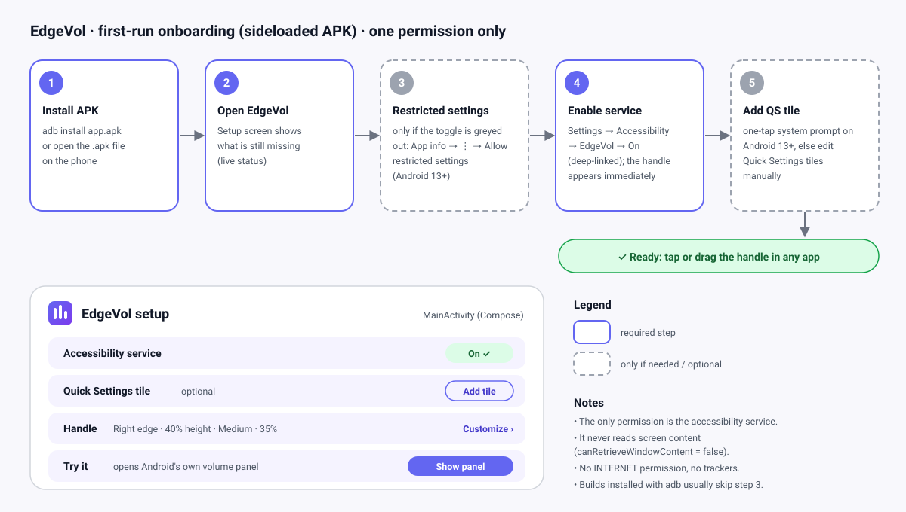

# 05 · Onboarding & permissions

## First-run flow

1. **Install the APK.** `adb install app-release.apk` is preferred (usually avoids step 3), or open the `.apk` on the phone.
2. **Open EdgeVol.** The setup screen shows live status that updates in `onResume`.
3. **Allow restricted settings** *(only if the Accessibility toggle is greyed out; Android 13+ sideloads).* Settings → Apps → EdgeVol → **⋮** → *Allow restricted settings*. The setup screen offers an *Open app info* button (`Settings.ACTION_APPLICATION_DETAILS_SETTINGS`).
4. **Enable the service.** The *Enable* button deep-links to `Settings.ACTION_ACCESSIBILITY_SETTINGS`. Once it's on, the edge handle appears immediately.
5. **Add the QS tile** *(optional).* On Android 13+ a one-tap system prompt via `StatusBarManager.requestAddTileService()`; on older versions, short instructions to edit the Quick Settings tiles.

✅ **Ready:** tap the handle to see the phone's own volume panel, in any app. Touch and hold it, then drag, to park it on the left or right edge (remembered across restarts).

### Service enabled but not running (MIUI and similar)

When the app process is killed or force-stopped, Android lists the service under *Crashed services*, although the Accessibility setting still reads "on". It re-binds by itself only if the phone allows the restart. The setup screen detects this (`SetupStatus.serviceRunning == false` while `serviceEnabled`) and shows the *Enabled but not running* state: a plain explanation, the Autostart card on Xiaomi-family phones, a button to Accessibility settings, and a "switch off and on once more" line.

**What actually stops EdgeVol on MIUI (verified on the POCO X2, 2026-10-17):**
- **"Clear all" (MIUI *OneKeyClean*) kills every unlocked app's process**, EdgeVol included. Android then schedules a restart (≈ 30–50 s, minutes if it happens again quickly), which MIUI rejects (`AutoStartManagerService: Reject RestartService`) unless **Autostart** is allowed. **Locking EdgeVol in Recents** (long-press its card → lock) puts it in MIUI's `locked_apps` list, which "clear all" skips entirely (verified: 27 processes killed, EdgeVol untouched). On Xiaomi, Redmi and POCO phones the setup screen shows a one-time **Keep EdgeVol running** card: allow Autostart (its button opens MIUI's Autostart list, fallback App info) and lock the card. Autostart alone brings EdgeVol back after the delay above; the lock prevents the kill.
- **Developer options → Select debug app = EdgeVol** (possible only with the debuggable debug build) makes Android force-stop EdgeVol every time it leaves Recents, with the log reason `set debug app`. Leave it at *None*.
- **Reboot works** without help: the service starts after the first unlock (it is not direct-boot aware).

Recovery when it is still not running: Settings → Accessibility → Downloaded apps → EdgeVol → switch **off**, then **on**. The first off/on cycle after a crash sometimes fails to draw the handle (a second cycle works). A force-stop from App info also switches the service off in Settings (the screen then shows *Off*).

## Permissions

| Permission / capability | Why | When requested | If denied |
|---|---|---|---|
| **Accessibility service** (`BIND_ACCESSIBILITY_SERVICE`, granted by the user enabling it) | Draw the edge handle over every app; collapse the shade when the tile is used (M3) | Setup step 4 | No handle. The QS tile (M3) opens setup instead |
| `INTERNET` | — | **Never requested** | — |
| `SYSTEM_ALERT_WINDOW` | — | **Not needed** (accessibility overlay) | — |
| `ACCESS_NOTIFICATION_POLICY` (DND) | — | **Not needed**: EdgeVol never changes the volume itself, it only shows the system panel, whose sliders SystemUI is allowed to change | — |
| Foreground service / `POST_NOTIFICATIONS` | — | **Not needed** | — |
| Boot receiver | — | **Not needed**: the system re-binds enabled accessibility services after boot | — |

Showing the system volume panel (`AudioManager.adjustSuggestedStreamVolume` with `ADJUST_SAME` + `FLAG_SHOW_UI`) needs **no permission at all**.

## Accessibility service disclosure (shown before step 4)

> **EdgeVol uses Android's Accessibility service only to keep its small volume handle on the screen edge, above other apps.**
> It does not read, collect or send anything on your screen, and it has no internet access. The handle only asks your phone to show its volume panel.

The code-level facts (`canRetrieveWindowContent = false`, no `INTERNET` permission) are enforced by tests, not stated in user-facing text. The Quick Settings tile sentence ("closing the notification shade when you use the Quick Settings tile") is added in M3 together with the tile.

The shipped `@string/a11y_service_description` (shown by Android on the accessibility settings page) and the in-app disclosure (`setup_disclosure_body`) use this exact text (M2.1; it said "show or change the volume" until the drag-volume gesture was removed):

> EdgeVol uses Android's Accessibility service only to keep its small volume handle on the screen edge, above other apps. It does not read, collect or send anything on your screen, and it has no internet access. The handle only asks your phone to show its volume panel.

## Privacy summary

- No network permission, so data cannot leave the device.
- No screen-content access.
- Settings (handle side and position; later size and opacity) are stored locally in DataStore and removed on uninstall.
- No analytics, ads or crash-reporting SDKs.
