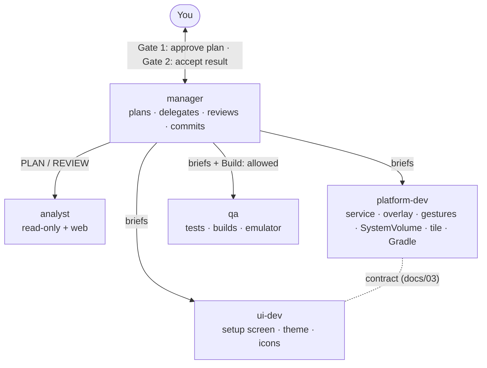
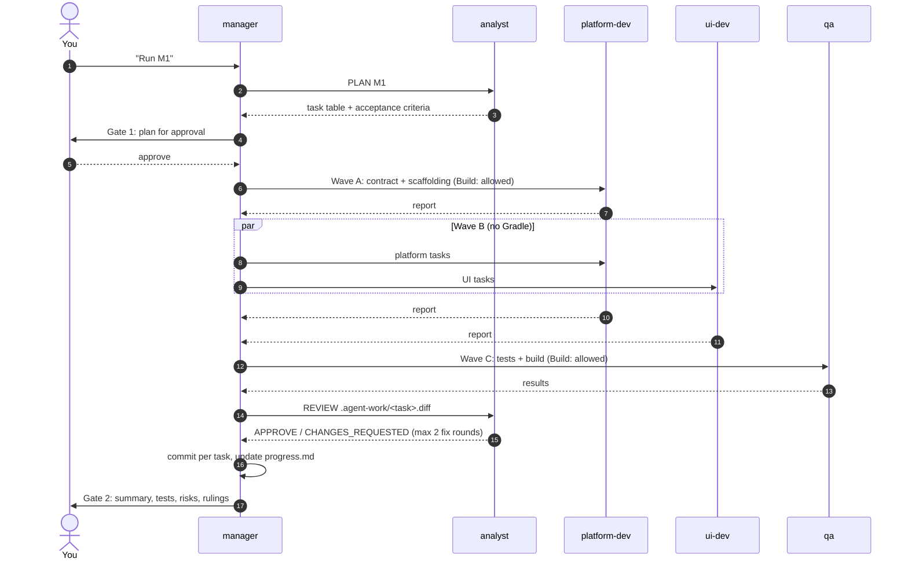

# 07 · Agent team (multi-agent workflow)

EdgeVol is built by a small **team of Copilot custom agents** defined in this repo ([`.github/agents/`](../.github/agents/)). A **manager** plans, delegates, reviews and integrates. Four specialists each own a slice of the codebase.

## Roles

| Agent | Role | Tools | Owns | Skills it reads |
|---|---|---|---|---|
| [`manager`](../.github/agents/manager.agent.md) | Orchestrator: plans, delegates, reviews, commits, reports | agent, read, search, edit, execute, todo | `docs/**`, `.github/**`, `.gitignore`, git | — |
| [`analyst`](../.github/agents/analyst.agent.md) | Task briefs + acceptance criteria (PLAN); spec/bug/invariant review of diffs (REVIEW) | read, search, web | nothing (read-only) | android-permissions-security |
| [`platform-dev`](../.github/agents/platform-dev.agent.md) | "Backend": accessibility service, handle overlay and gestures, `SystemVolume`, tile, prefs, manifest, Gradle | read, edit, search, execute | see the ownership map | android-permissions-security, android-cli |
| [`ui-dev`](../.github/agents/ui-dev.agent.md) | "Frontend": setup/settings screen, theme, icons, debug-only `@Preview`s (`app/src/debug/java/app/edgevol/ui/**`) | read, edit, search, execute | see the ownership map | mobile-android-design, edge-to-edge, compose-animations |
| [`qa`](../.github/agents/qa.agent.md) | Tests, the designated Gradle runner, emulator/device checks | read, edit, search, execute | `app/src/test/**`, `app/src/androidTest/**` | testing-setup, android-cli |

The exact path-ownership map and shared rules live in [`.github/copilot-instructions.md`](../.github/copilot-instructions.md), which every agent loads automatically.

## How a milestone runs

## Guardrails

| Problem | Guardrail |
|---|---|
| Two agents editing one file | Strict path ownership. Shared files (manifest, Gradle, `strings_system.xml`) belong to `platform-dev`; others send *change requests* |
| Parallel Gradle runs lock each other | Only the agent whose brief says `Build: allowed` runs `./gradlew` |
| UI and platform drift apart | One written contract ([03 § Contract](03-architecture.md#ui--platform-contract)); changes need manager approval |
| Specialists can't ask you questions | They return `Questions:`; the manager answers from the docs or asks you |
| Endless fix loops | Max 2 fix rounds per task, then the manager rules and records `Ruling:` in [progress.md](progress.md) |
| Agents spawning agents | Only the manager delegates (`agents:` list; VS Code blocks nested subagents by default) |
| Token cost | Each hand-off is a fresh context. For ≤ 2-file, one-owner changes the manager skips planning, or you call the specialist directly |

## How to use it

- **VS Code (Copilot Chat):** pick **manager** in the agents dropdown, then e.g. *"Run M1 skeleton"*. For a small change, pick the specialist directly (e.g. **ui-dev**: *"make the setup screen's Try-it button full-width"*).
- **Copilot CLI:** run `/agent`, choose `manager`, then give the same prompt.
- Agents appear after a window reload or in a new session.
- `agents:` is honored in VS Code; the Copilot CLI ignores it, so each agent's body also names its allowed workers.

## Is it worth it?

Total complexity doesn't go down; it moves into coordination. The payoff here is **smaller focused contexts**, **an independent reviewer on every task**, and **parallel UI/platform work once the contract exists**. For one-line fixes, skip the team and ask a specialist directly.
