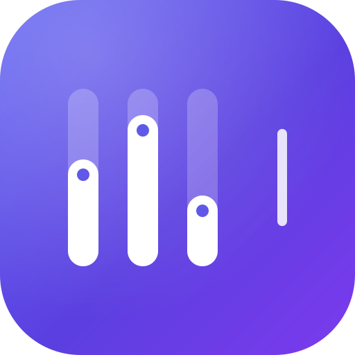
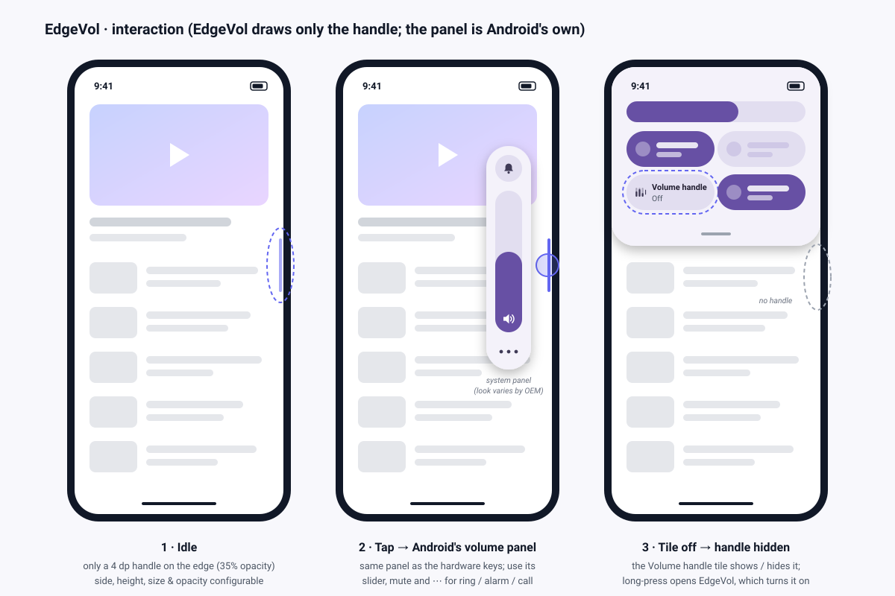

  

<h1 align="center">EdgeVol: hidden, system-wide volume keys for Android</h1>

<i>Working name. Your volume buttons are broken, so get them back on the screen edge, in every app.</i>

---

## What it is

EdgeVol is a minimal Android app that replaces the hardware volume keys with an invisible **edge handle** that works **in any app**:

- **Hidden by default.** Only a 4 dp sliver sits on the screen edge (or nothing at all if you use the Quick Settings tile, M3).
- **Tap** the handle to bring up **Android's own volume panel**, the same one the hardware keys show. The panel's own sliders change the volume; EdgeVol never does.
- **Touch and hold, then drag** to park the handle on the left or right edge at any height. It widens while you hold it and remembers where you left it.
- **All streams.** Media, ring, notification, alarm and call through the system panel's own expand button.
- **Private.** No `INTERNET` permission, no trackers, and it never reads screen content.

## Decisions so far

| Topic | Decision | Why |
|---|---|---|
| Distribution | **Sideloaded APK** (personal use) | Lets us use the most robust engine without Play's AccessibilityService declaration form, prominent-disclosure screen and review |
| Engine | **AccessibilityService + `TYPE_ACCESSIBILITY_OVERLAY`** | Draws over every app *and* the notification shade, isn't hidden by apps that block overlays, needs no foreground notification, and isn't killed by OEM battery savers |
| Volume UI | **Android's built-in volume panel** (`FLAG_SHOW_UI`), no custom panel | Identical to the hardware keys, native look on every OEM, least code, no DND permission |
| Triggers | **Invisible edge handle (tap = show the system panel, hold + drag = park it left/right) + Quick Settings tile** | Always reachable, never in the way; no drag-volume gesture (M2.1, user decision), so nothing competes with the horizontal back gesture |
| Stack | **Kotlin, Jetpack Compose (Material 3, setup screen only), single module, DataStore** | All the work is native system integration, so cross-platform frameworks add nothing |
| Min / target SDK | **26 / 36** | Android 8+ covers almost every device in use |
| Dev workflow | **Repo-scoped agent team**: manager + analyst, UI dev, platform dev, QA | Small per-agent context, independent review, strict file ownership ([07](07-agent-team.md)) |

## Document map

| # | Document | What's inside |
|---|---|---|
| 01 | [Competitor research](01-competitor-research.md) | Existing apps, how they're triggered and built, gaps we fill |
| 02 | [Feasibility & constraints](02-feasibility-and-constraints.md) | Does it work in *every* app? Platform limits, handle host and volume-UI decisions, risks |
| 03 | [Architecture](03-architecture.md) | Components, gesture flows, state machine, manifest, UI ↔ platform contract |
| 04 | [UI design](04-ui-design.md) | Handle gestures, system panel behavior, haptics, theming, setup screen |
| 05 | [Onboarding & permissions](05-onboarding-and-permissions.md) | First-run flow, every permission and why, privacy |
| 06 | [Build, test & release](06-build-test-release.md) | Toolchain, agent skills, test strategy and device matrix, signing |
| 07 | [Agent team](07-agent-team.md) | Multi-agent workflow: manager + specialists, file ownership, gates |
| — | [Progress log](progress.md) | Task results and rulings per milestone |

## Roadmap

| Milestone | Scope | Status |
|---|---|---|
| **M0 Setup** | Repo-scoped skills and agent team, documentation, temporary logo, git | ✅ done |
| **M1 Skeleton** | Gradle project, theme, setup screen with live service status | ✅ done (build, unit tests, lint and manifest verified; status detection and enable flow verified on a POCO X2, see [progress](progress.md)) |
| **M2 Core engine** | `VolumeAccessibilityService`, edge handle overlay, gestures, `SystemVolume`, `ui-tooling` previews | ✅ built and verified on a POCO X2 (see [progress](progress.md)) |
| **M2.1 Handle rework** | Drag-volume removed; tap toggle; hold → widen → drag → snap to either side; side + position persisted (DataStore `Prefs` subset, brought forward from M3); setup screen with Off / enabled-but-not-running / Running states | ✅ built and checked on a POCO X2 ([progress](progress.md)) |
| **M2.2 Survival & rotation** | Handle keeps its relative height on rotation; one-time *Keep EdgeVol running* card (MIUI Autostart + lock in Recents) | ✅ 146 unit tests, lint, manifests; rotation, Autostart restart and locked "clear all" verified on a POCO X2 ([progress](progress.md#m22--survival-and-rotation-)) |
| **M3 Triggers & settings** | Quick Settings tile "Volume handle" = show/hide switch (long-press opens EdgeVol; opening EdgeVol turns the handle on); handle Show switch, side, height, size and opacity on the setup screen, applied live | ✅ 163 unit tests, lint, manifests; settings and the tile verified on a POCO X2 ([progress](progress.md#m3--triggers-and-settings-)) |
| **M4 Polish** | Release build + personal signing key (≈ 1.2 MB APK), adaptive launcher icon with themed (monochrome) layer, no white flash in dark mode, TalkBack move actions on the handle, haptics follow the system setting, lint cleanup, doc images refreshed | ✅ 167 unit tests, lint (only the agreed `OldTargetApi`), manifests; release build verified on a POCO X2 ([progress](progress.md#m4--polish-)) |
| **M5 Test & ship** | Robolectric (JVM) tests for the setup screen, overlay window, TalkBack actions and tile on simulated Android 8.0 / 11 / 15 (no emulators, user decision); `scripts/phone-check.sh` on the phone; matrix and definition of done updated | ✅ 223 tests (mutation-checked), lint, manifests; phone check 9 PASS / 1 SKIP (tile: adb can't click MIUI tiles) ([progress](progress.md#m5--test--ship-)). Open by hand: reboot, TalkBack, gesture nav, streams; no non-MIUI phone |

## Logo (temporary)

| Full-color | Monochrome glyph (tile / small icons) |
|---|---|
|  |  |

Three volume pills at different levels, plus the "hidden edge handle" on the right: a quick visual summary of the product. It's meant to be replaced before any public release.
